

  <a href="https://macleodlabs.ai/contact.html" title="Hire Steve Messina">
    <picture>
      <source media="(prefers-color-scheme: dark)" srcset="assets/hire-card-dark.svg">
      
    </picture>
  </a>

  <a href="https://macleodlabs.ai">Website</a> ·
  <a href="https://macleodlabs.com">Products</a> ·
  <a href="https://blog.macleodlabs.ai">Blog</a> ·
  <a href="https://www.linkedin.com/in/stevegmessina">LinkedIn</a> ·
  <a href="mailto:steve@macleodlabs.ai">steve@macleodlabs.ai</a> ·
  <a href="https://macleodlabs.ai/contact.html"><b>Hire me</b></a> ·
  <a href="https://github.com/macleodlabs-ai">@macleodlabs-ai</a>

I'm Steve Messina. I build agent systems that survive production: the harness that runs them, the checks that keep them honest, and the products on top. Macleod Labs is my studio. Before it I was founder and CTO of Azara.ai and AWS CTO at IBM; through Macleod Labs I've been CTO at Graph8 and worked with Snyk, VCyberiz and Newton Russell, and today I'm Chief AI Architect at [TensorLot](https://tensorlot.ai), working on agentic data quality at scale.

The calendar counts each day as the larger of my GitHub contributions and the commits in my local clones, so private client work shows and pushed commits count once.

### What I'm shipping

Newest first. Every one is a Macleod Labs product; client work is in the timeline below.

<table>
<tr><td width="33%" valign="top"><a href="https://macleodcodes.com/">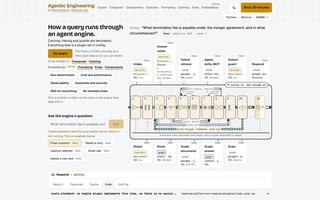</a> <a href="https://macleodcodes.com/"><b>Agentic Engineering</b></a> Course · invite-only · Oct 2026 How a query runs through an agent engine</td><td width="33%" valign="top"><a href="https://thecatthatcodes.com/">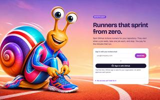</a> <a href="https://thecatthatcodes.com/"><b>spotfleet</b></a> Internal · Oct 2026 Runners that sprint from zero</td><td width="33%" valign="top"><a href="https://fractal.macleodlabs.com/">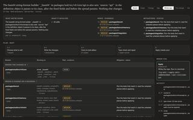</a> <a href="https://fractal.macleodlabs.com/"><b>Fractal</b></a> Free preview · Oct 2026 Build using architecture, not lines of code</td></tr>
<tr><td width="33%" valign="top"><a href="https://provely.macleodlabs.com/">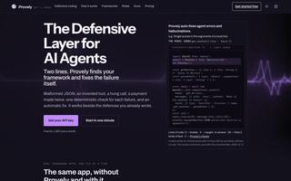</a> <a href="https://provely.macleodlabs.com/"><b>Provely</b></a> Live · Oct 2026 Add 2 lines of code and it handles all your agentic defensive coding automatically.</td><td width="33%" valign="top"><a href="https://streams.macleodlabs.com/">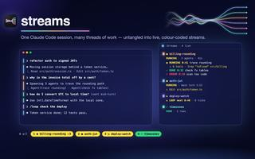</a> <a href="https://streams.macleodlabs.com/"><b>Streams</b></a> Live · Oct 2026 One Claude Code session, untangled, plus Remote Control++</td><td width="33%" valign="top"><a href="https://macleodlabs.ai/portfolio/codercat/">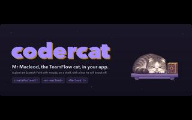</a> <a href="https://macleodlabs.ai/portfolio/codercat/"><b>codercat</b></a> Drop-in SDK · Oct 2026 Mr Macleod, the Macleod Labs mascot, in any app</td></tr>
<tr><td width="33%" valign="top"><a href="https://macleodlabs.ai/portfolio/vault/">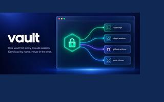</a> <a href="https://macleodlabs.ai/portfolio/vault/"><b>Vault</b></a> Runs on your Mac · Oct 2026 Secure secrets vault across all your Claude Code sessions</td><td width="33%" valign="top"><a href="https://teamflow.macleodlabs.com/">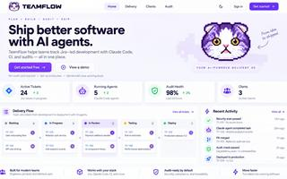</a> <a href="https://teamflow.macleodlabs.com/"><b>TeamFlow</b></a> Live · Sep 2026 The DevOps harness for agentic software delivery</td><td width="33%" valign="top"> <a href="https://macleodlabs.ai/portfolio/modular/"><b>Modular</b></a> Prototype · Aug 2026 Designing industrial processes like modular software</td></tr>
<tr><td width="33%" valign="top"><a href="https://macleodlabs.ai/portfolio/catscan/">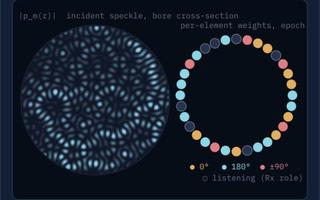</a> <a href="https://macleodlabs.ai/portfolio/catscan/"><b>catscan</b></a> Prototype · Aug 2026 Conceptual Holographic Body Scanner</td><td width="33%" valign="top"> <a href="https://heart.macleodlabs.com/"><b>Heart</b></a> Prototype · Aug 2026 A causal 4D beating heart with a live 12-lead ECG</td><td width="33%" valign="top"><a href="https://mechkit.macleodlabs.com/">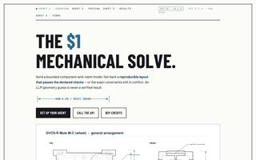</a> <a href="https://mechkit.macleodlabs.com/"><b>MechKit</b></a> Live · Aug 2026 The $1 mechanical solve</td></tr>
<tr><td width="33%" valign="top"><a href="https://doc.macleodlabs.com/">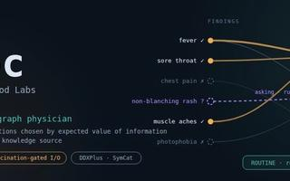</a> <a href="https://doc.macleodlabs.com/"><b>Doc</b></a> Prototype · access code · Aug 2026 Probabilistic causal diagnosis</td><td width="33%" valign="top"><a href="https://macleodlabs.ai/portfolio/claude-sessions/">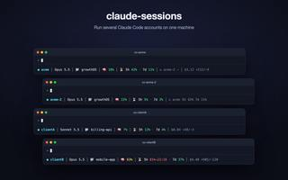</a> <a href="https://macleodlabs.ai/portfolio/claude-sessions/"><b>claude-sessions</b></a> Open source · MIT · Jun 2026 Several Claude Code accounts on one machine</td><td width="33%" valign="top"><a href="https://grow.macleodlabs.com/">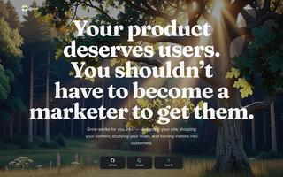</a> <a href="https://grow.macleodlabs.com/"><b>Grow</b></a> Beta · Jun 2026 Your product deserves users</td></tr>
<tr><td width="33%" valign="top"> <a href="https://script.macleodlabs.com/"><b>Scriptorium</b></a> Closed beta · Jun 2026 A loop of agents that writes a book</td><td width="33%" valign="top"> <a href="https://macleodlabs.ai/portfolio/flow-evacuation-twin/"><b>flow</b></a> Prototype · Jun 2026 An evacuation digital twin of Dubai</td><td width="33%" valign="top"><a href="https://macleodlabs.ai/portfolio/mcclawd/">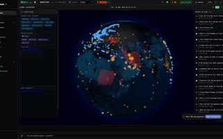</a> <a href="https://macleodlabs.ai/portfolio/mcclawd/"><b>McClawd</b></a> Private beta · Mar 2026 Secure, OpenClaw-compatible agents that run each task in its own container</td></tr>
</table>

### Open source

- [**claude-sessions**](https://github.com/macleodlabs-ai/claude-sessions): Utility skill to allow multiple simultaneous Claude sessions on different subscriptions for different clients
- [**workspec**](https://github.com/macleodlabs-ai/workspec): Anti-workslop - an agent skill and specification for automated quality control of human and AI generated work
- [**claudeflow**](https://github.com/macleodlabs-ai/claudeflow): Claude Code mods by MacLeod Labs: streams untangles a session's interleaved work into colour-coded streams
- [**fractal-plugin**](https://github.com/macleodlabs-ai/fractal-plugin): Fractal for Claude Code: change or map TypeScript and Python repos, judged by the repo's own checks
- [**teamflow-plugin**](https://github.com/macleodlabs-ai/teamflow-plugin) · [**ironbox-sec**](https://github.com/macleodlabs-ai/ironbox-sec) · [**code-review-graph**](https://github.com/macleodlabs-ai/code-review-graph)

### Where I've been

<picture>
  <source media="(prefers-color-scheme: dark)" srcset="assets/roles-dark.svg">
  <source media="(prefers-color-scheme: light)" srcset="assets/roles-light.svg">
  
</picture>

Earlier: AWS, HSBC, Bank of America Merrill Lynch, UBS, Morgan Stanley. Full history at <a href="https://macleodlabs.ai/about.html">macleodlabs.ai/about</a>.
