

  <a href="https://macleodlabs.ai/contact.html" title="Hire Steve Messina">
    <picture>
      <source media="(prefers-color-scheme: dark)" srcset="assets/hire-card-dark.svg">
      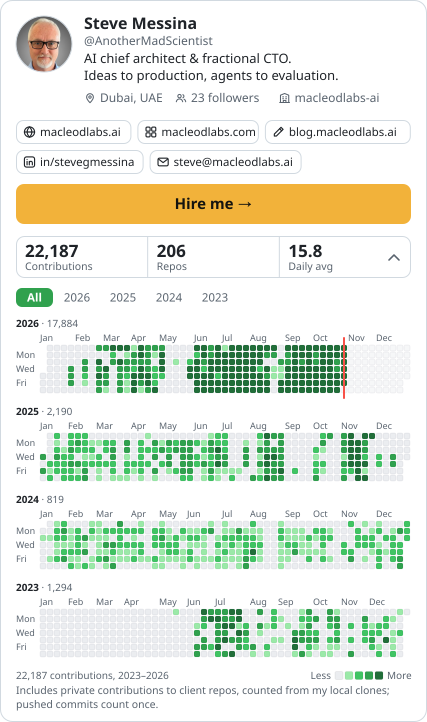
    </picture>
  </a>

  <a href="https://macleodlabs.ai">Website</a> ·
  <a href="https://macleodlabs.com">Products</a> ·
  <a href="https://blog.macleodlabs.ai">Blog</a> ·
  <a href="https://www.linkedin.com/in/stevegmessina">LinkedIn</a> ·
  <a href="mailto:steve@macleodlabs.ai">steve@macleodlabs.ai</a> ·
  <a href="https://macleodlabs.ai/contact.html"><b>Hire me</b></a> ·
  <a href="https://github.com/macleodlabs-ai">@macleodlabs-ai</a>

I'm Steve Messina. I build agent systems that survive production: the harness that runs them, the checks that keep them honest, and the products on top. Macleod Labs is my studio. Before it I was founder and CTO of Azara.ai and AWS CTO at IBM; through Macleod Labs I've been CTO at Graph8 and worked with Snyk, VCyberiz and Newton Russell, and today I'm Chief AI Architect at [TensorLot](https://tensorlot.ai), working on agentic data quality at scale.

The calendar counts each day as the larger of my GitHub contributions and the commits in my local clones, so private client work shows and pushed commits count once.

### What I'm shipping

  <a href="https://macleodlabs.com" title="All products on macleodlabs.com">
    <picture>
      <source media="(prefers-color-scheme: dark)" srcset="assets/portfolio-strip-dark.svg">
      
    </picture>
  </a>

The same list as <a href="https://macleodlabs.com">macleodlabs.com</a>, in its order. Client work is in the timeline below.

<table>
<tr><td width="33%" valign="top"><a href="https://teamflow.macleodlabs.com/">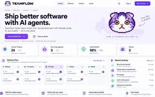</a> <a href="https://teamflow.macleodlabs.com/"><b>TeamFlow</b></a> Live <b>The DevOps harness for agentic software delivery</b> Every agent workstream on one board. Stuck agents found and fixed, and code that never leaves your organisation. <a href="https://teamflow.macleodlabs.com/">Open</a> · <a href="https://macleodlabs.ai/portfolio/teamflow/">Case study</a></td><td width="33%" valign="top"><a href="https://macleodlabs.ai/portfolio/codercat/">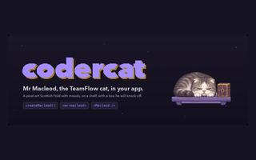</a> <a href="https://macleodlabs.ai/portfolio/codercat/"><b>codercat</b></a> Drop-in SDK <b>Mr Macleod, the Macleod Labs mascot, in any app</b> The animated pixel-art Scottish Fold from TeamFlow as a drop-in component and SDK: he sleeps on his shelf, wakes, looks up and knocks his glowing box off. <a href="https://macleodlabs.ai/portfolio/codercat/">Case study</a></td><td width="33%" valign="top"><a href="https://provely.macleodlabs.com/">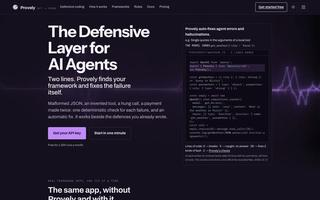</a> <a href="https://provely.macleodlabs.com/"><b>Provely</b></a> Live <b>Add 2 lines of code and it handles all your agentic defensive coding automatically.</b> Two lines in an agent: Provely finds the framework, checks every model answer and tool call, and fixes the failure itself. <a href="https://provely.macleodlabs.com/">Open</a> · <a href="https://macleodlabs.ai/portfolio/provely/">Case study</a></td></tr>
<tr><td width="33%" valign="top"><a href="https://fractal.macleodlabs.com/">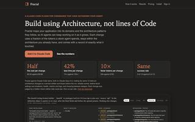</a> <a href="https://fractal.macleodlabs.com/"><b>Fractal</b></a> Free preview <b>Build using architecture, not lines of code</b> A Claude Code plugin that maps your codebase by domain and pattern. Changes at half the cost and a tenth of the tokens, with a proof of what they touched. <a href="https://fractal.macleodlabs.com/">Open</a> · <a href="https://macleodlabs.ai/portfolio/fractal/">Case study</a></td><td width="33%" valign="top"><a href="https://macleodcodes.com/">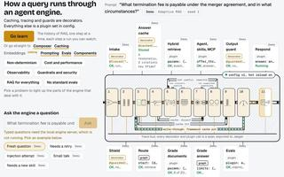</a> <a href="https://macleodcodes.com/"><b>Agentic Engineering</b></a> Course · invite-only <b>How a query runs through an agent engine</b> A hands-on course in agentic engineering: a config-driven agent engine you step through, every stage, trace, cache hit and line of code of a recorded run. <a href="https://macleodcodes.com/">Open</a> · <a href="https://macleodlabs.ai/portfolio/agentic-engineering/">Case study</a></td><td width="33%" valign="top"> <a href="https://streams.macleodlabs.com/"><b>Streams</b></a> Live <b>One Claude Code session, untangled, plus Remote Control++</b> Formerly claudeflow. Sorts side questions, loops and subagents into colour-coded live streams. Streams Remote, Claude Remote Control++, puts every session on your phone, end to end encrypted. <a href="https://streams.macleodlabs.com/">Open</a> · <a href="https://macleodlabs.ai/portfolio/claudeflow/">Case study</a></td></tr>
<tr><td width="33%" valign="top"> <a href="https://macleodlabs.ai/portfolio/vault/"><b>Vault</b></a> Runs on your Mac <b>Secure secrets vault across all your Claude Code sessions</b> Keys load by name, never into the chat, from one master list in AWS Secrets Manager. Approve with Touch ID or a passkey. <a href="https://macleodlabs.ai/portfolio/vault/">Case study</a></td><td width="33%" valign="top"><a href="https://heart.macleodlabs.com/">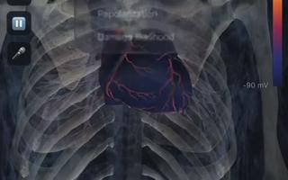</a> <a href="https://heart.macleodlabs.com/"><b>Heart</b></a> Prototype <b>A causal 4D beating heart with a live 12-lead ECG</b> CT-derived four-chamber anatomy driven by a physiological activation model, rendered live in the browser. <a href="https://heart.macleodlabs.com/">Open</a> · <a href="https://macleodlabs.ai/portfolio/heart/">Case study</a></td><td width="33%" valign="top"> <a href="https://doc.macleodlabs.com/"><b>Doc</b></a> Prototype · access code <b>Probabilistic causal diagnosis</b> Exact noisy-OR inference over a causal knowledge graph that always asks the most informative next question. <a href="https://doc.macleodlabs.com/">Open</a> · <a href="https://macleodlabs.ai/portfolio/doc/">Case study</a></td></tr>
<tr><td width="33%" valign="top"> <a href="https://thecatthatcodes.com/"><b>spotfleet</b></a> Internal <b>Runners that sprint from zero</b> Spot GitHub Actions runners for each client: they start when a job waits, take one job each, and stop. A console shows the cost in euros and dollars. <a href="https://thecatthatcodes.com/">Open</a> · <a href="https://macleodlabs.ai/portfolio/spotfleet/">Case study</a></td><td width="33%" valign="top"><a href="https://macleodlabs.ai/portfolio/mcclawd/">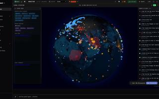</a> <a href="https://macleodlabs.ai/portfolio/mcclawd/"><b>McClawd</b></a> Private beta <b>Secure, OpenClaw-compatible agents that run each task in its own container</b> A Rust agent platform that keeps OpenClaw's skills and workspace files, runs each task in its own Docker container, keeps secrets out of the model's context and screens every tool call through security hooks. Its home screen embeds WorldMonitor in a secure space. <a href="https://macleodlabs.ai/portfolio/mcclawd/">Case study</a></td><td width="33%" valign="top"><a href="https://macleodlabs.ai/portfolio/claude-sessions/">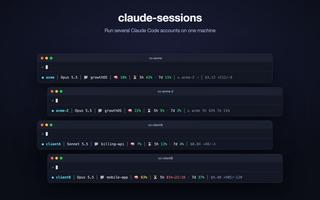</a> <a href="https://macleodlabs.ai/portfolio/claude-sessions/"><b>claude-sessions</b></a> Open source · MIT <b>Several Claude Code accounts on one machine</b> A launcher, memory and labelled footer for each client account, plus a pool of accounts that a session rotates onto when it hits a rate limit, resuming the same conversation. <a href="https://macleodlabs.ai/portfolio/claude-sessions/">Case study</a></td></tr>
<tr><td width="33%" valign="top"><a href="https://mechkit.macleodlabs.com/">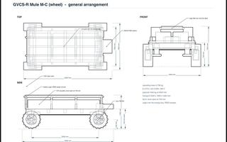</a> <a href="https://mechkit.macleodlabs.com/"><b>MechKit</b></a> Live <b>The $1 mechanical solve</b> Send a bounded component-and-claim model; get back a reproducible layout that passes its checks, or the exact constraints in conflict. <a href="https://mechkit.macleodlabs.com/">Open</a> · <a href="https://macleodlabs.ai/portfolio/mechkit/">Case study</a></td><td width="33%" valign="top"> <a href="https://grow.macleodlabs.com/"><b>Grow</b></a> Beta <b>Your product deserves users</b> Researches your product, rebuilds your site, writes and distributes content, studies competitors and measures real outcomes. <a href="https://grow.macleodlabs.com/">Open</a> · <a href="https://macleodlabs.ai/portfolio/grow/">Case study</a></td><td width="33%" valign="top"> <a href="https://script.macleodlabs.com/"><b>Scriptorium</b></a> Closed beta <b>A loop of agents that writes a book</b> Agents plan, write and illustrate whole books on a Vonnegut fortune curve, with a live chalkboard of the agents at work. The shelf holds novels, novellas and short stories. <a href="https://script.macleodlabs.com/">Open</a> · <a href="https://macleodlabs.ai/portfolio/scriptorium/">Case study</a></td></tr>
<tr><td width="33%" valign="top"><a href="https://macleodlabs.ai/portfolio/modular/">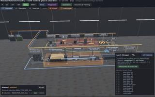</a> <a href="https://macleodlabs.ai/portfolio/modular/"><b>Modular</b></a> Prototype <b>Designing industrial processes like modular software</b> A materials plant on one deterministic kernel: live glass and steel lines in 3D, agents tuned on headless replays, and the MMS standard for exchangeable modules. <a href="https://macleodlabs.ai/portfolio/modular/">Case study</a></td><td width="33%" valign="top"><a href="https://macleodlabs.ai/portfolio/catscan/">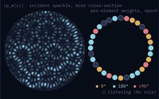</a> <a href="https://macleodlabs.ai/portfolio/catscan/"><b>catscan</b></a> Prototype <b>Conceptual Holographic Body Scanner</b> A digital twin of a conceptual holographic body scanner, with illustrative speckle fields computed live from the equations. <a href="https://macleodlabs.ai/portfolio/catscan/">Case study</a></td><td width="33%" valign="top"><a href="https://macleodlabs.ai/portfolio/flow-evacuation-twin/">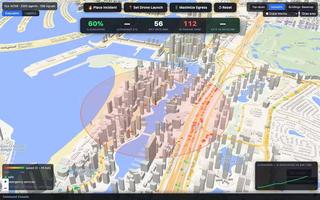</a> <a href="https://macleodlabs.ai/portfolio/flow-evacuation-twin/"><b>flow</b></a> Prototype <b>An evacuation digital twin of Dubai</b> Place a fire in Dubai Marina, watch agents evacuate over the real OpenStreetMap road network, then make one operator decision and measure the clearance time it saves. <a href="https://macleodlabs.ai/portfolio/flow-evacuation-twin/">Case study</a></td></tr>
<tr><td width="33%" valign="top"><a href="https://macleodlabs.ai/portfolio/swarm-fleet-planner/">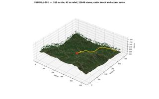</a> <a href="https://macleodlabs.ai/portfolio/swarm-fleet-planner/"><b>Swarm Fleet Planner</b></a> Prototype <b>Autonomous fleet planning on real terrain</b> Plans work for a fleet of vehicles over a terrain model: haul roads, soil, slope and water layers, a task board and a construction plan. <a href="https://macleodlabs.ai/portfolio/swarm-fleet-planner/">Case study</a></td><td width="33%" valign="top"><a href="https://macleodlabs.ai/portfolio/mechanic/">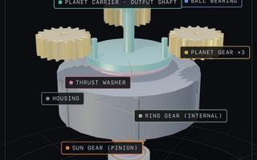</a> <a href="https://macleodlabs.ai/portfolio/mechanic/"><b>Mechanic</b></a> Prototype <b>Step-by-step 3D disassembly</b> Interactive 3D disassembly guides with labelled parts, X-ray views and instructions for each step. <a href="https://macleodlabs.ai/portfolio/mechanic/">Case study</a></td><td width="33%" valign="top"><a href="https://macleodlabs.ai/portfolio/evolutionary-engine-designer/">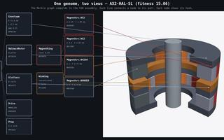</a> <a href="https://macleodlabs.ai/portfolio/evolutionary-engine-designer/"><b>Evolutionary Engine Designer</b></a> Prototype <b>One genome, two views</b> Evolves electric motor topologies: each genome renders as a design graph and a 3D cutaway, and the elite designs are compared. <a href="https://macleodlabs.ai/portfolio/evolutionary-engine-designer/">Case study</a></td></tr>
</table>

### Open source

- [**claude-sessions**](https://github.com/macleodlabs-ai/claude-sessions): Utility skill to allow multiple simultaneous Claude sessions on different subscriptions for different clients
- [**workspec**](https://github.com/macleodlabs-ai/workspec): Anti-workslop - an agent skill and specification for automated quality control of human and AI generated work
- [**claudeflow**](https://github.com/macleodlabs-ai/claudeflow): Claude Code mods by MacLeod Labs: streams untangles a session's interleaved work into colour-coded streams
- [**fractal-plugin**](https://github.com/macleodlabs-ai/fractal-plugin): Fractal for Claude Code: change or map TypeScript and Python repos, judged by the repo's own checks
- [**teamflow-plugin**](https://github.com/macleodlabs-ai/teamflow-plugin) · [**ironbox-sec**](https://github.com/macleodlabs-ai/ironbox-sec) · [**code-review-graph**](https://github.com/macleodlabs-ai/code-review-graph)

### Where I've been

<picture>
  <source media="(prefers-color-scheme: dark)" srcset="assets/roles-dark.svg">
  <source media="(prefers-color-scheme: light)" srcset="assets/roles-light.svg">
  
</picture>

Earlier: AWS, HSBC, Bank of America Merrill Lynch, UBS, Morgan Stanley. Full history at <a href="https://macleodlabs.ai/about.html">macleodlabs.ai/about</a>.
